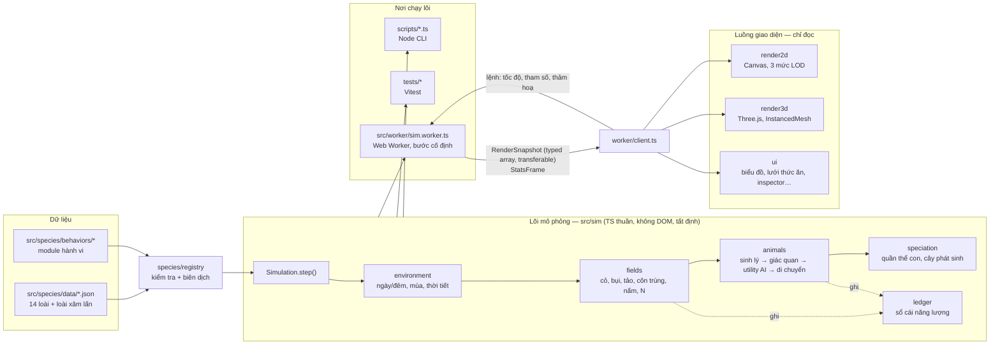

# 🌿 My Habitat

Mô phỏng hệ sinh thái tiến hoá chạy trên trình duyệt: 14 loài tương tác qua chuỗi thức ăn, có di truyền
lưỡng bội, tiến hoá do chọn lọc tự nhiên, và có thể tách thành phân loài khi bị cách ly địa lý.

- **Lõi mô phỏng** thuần TypeScript, tất định, chạy được trong Node, trong Web Worker và trong test.
- **Hiển thị** 2D (Canvas, mặc định) và 3D (Three.js, bật/tắt khi đang chạy), chỉ đọc ảnh chụp trạng thái.
- **Kiểm chứng bằng chạy thật**: CLI không giao diện, test tất định, test bảo toàn năng lượng/dinh dưỡng,
  test ổn định 20 seed. Kết quả đo ở [`docs/REPORT.md`](docs/REPORT.md).

## Chạy

Cần Node ≥ 22.12 và pnpm.

```bash
pnpm install
```

```bash
pnpm dev
```

Mở địa chỉ Vite in ra (mặc định `http://localhost:5173`). Tham số URL: `?seed=42`, `?scenario=lotka-volterra`,
`?paused=1`.

| Lệnh | Việc |
|---|---|
| `pnpm dev` | Chạy ứng dụng ở chế độ phát triển |
| `pnpm build` | Kiểm tra kiểu + đóng gói vào `dist/` |
| `pnpm test` | Unit test + test tất định + test bảo toàn (Vitest) |
| `pnpm lint` / `pnpm typecheck` / `pnpm format` | ESLint / TypeScript strict / Prettier |
| `pnpm sim --seed 42 --ticks 50000 --out report.json` | Chạy mô phỏng không giao diện, in tóm tắt, ghi báo cáo JSON |
| `pnpm stability` | Test ổn định: 20 seed × 20.000 tick, chạy song song |
| `pnpm bench` | Đo thời gian mỗi tick theo quy mô và theo hệ con |
| `pnpm lv` | Thí nghiệm con mồi–kẻ săn, khớp Lotka–Volterra, xuất CSV/JSON/SVG |
| `node scripts/run.mjs scripts/trace.ts --species wolf` | Công cụ gỡ lỗi: theo dõi trạng thái của một loài |

Tuỳ chọn của `pnpm sim`: `--scenario lotka-volterra`, `--species rabbit,fox` (chỉ thả các loài này),
`--count rabbit=500,fox=20`, `--param sunlight=1.2,mutationRate=0.2`, `--progress 1000`, `--quiet`.

## Điều khiển trong ứng dụng

- **Thanh trên:** tạm dừng (phím cách), tốc độ ×1 / ×10 / ×100 / tối đa, tắt vẽ, đổi 2D ↔ 3D, nhập seed,
  khởi tạo lại, chọn kịch bản, xuất CSV.
- **Bản đồ 2D:** cuộn để zoom, kéo để di chuyển, bấm vào con vật để chọn. Zoom gần để thấy ngoại hình theo gen.
- **Bản đồ 3D:** kéo để xoay, cuộn để zoom, chuột phải để dời; "Bám theo" trong bảng *Cá thể*.
- **Bảng bên phải:** Quần thể · Gen · Lưới thức ăn · Phân loài · Cá thể · Điều khiển (thanh trượt, thảm hoạ) ·
  Thí nghiệm (Lotka–Volterra).

## Kiến trúc



| Thư mục | Trách nhiệm |
|---|---|
| `src/sim` | Lõi: thế giới, thực thể (SoA), các hệ, di truyền, RNG, sổ cái. **Không** import DOM, `Date`, `Math.random`, `Math.sin/exp/pow…` (ESLint + `tsconfig.sim.json` chặn) |
| `src/species` | Lược đồ dữ liệu loài, file JSON của từng loài, module hành vi, bộ nạp/kiểm tra |
| `src/worker` | Giao thức tin nhắn, Worker chạy lõi với bước thời gian cố định, lớp bọc phía giao diện |
| `src/render` | Phần dùng chung của hai renderer (giao diện `WorldRenderer`, màu) |
| `src/render2d` | Canvas 2D: lớp nền, vẽ sinh vật bằng code theo gen, LOD |
| `src/render3d` | Three.js: heightmap, nước, cây và sinh vật instanced (tải lười khi bật 3D) |
| `src/ui` | Thanh công cụ, HUD, các bảng, kho lịch sử, vẽ biểu đồ |
| `src/analysis` | Khớp và giải Lotka–Volterra (công cụ phân tích, không thuộc lõi) |
| `scripts` | CLI: `sim`, `stability`, `bench`, `lv`, `hash`, `trace`; `run.mjs` đóng gói rồi chạy |
| `tests` | Unit test + tất định + bảo toàn + phân loài |
| `docs` | `PLAN.md` (kế hoạch), `MODELS.md` (mô hình sinh thái), `REPORT.md` (báo cáo), `data/` (số liệu đo) |

Các quyết định thiết kế chính và lý do: xem [`docs/REPORT.md`](docs/REPORT.md) mục 1.
Các mô hình sinh thái và chỗ đơn giản hoá: xem [`docs/MODELS.md`](docs/MODELS.md).

### Vòng đời một tick

1. `updateEnvironment` — giờ trong ngày, mùa, nhiệt độ; mỗi 40 tick cập nhật mưa/hạn/mực nước.
2. Dựng lại spatial hash (counting sort) và danh sách cá thể theo loài.
3. `updateFields` — cập nhật 1/12 số hàng của lưới (cỏ, cây bụi, quả, tảo, côn trùng, mùn, nấm, N đất).
4. `stepAnimals` — mọi cá thể di chuyển; 1/6 số cá thể "suy nghĩ": sinh lý → giác quan → chấm điểm các module
   hành vi → thực thi module điểm cao nhất.
5. Xác rữa dần; mỗi 30 tick cập nhật bầy sói; mỗi 600 tick kiểm tra tuyệt chủng và phân loài.

### Tính tất định

- Một RNG `sfc32` duy nhất (`src/sim/rng.ts`); thứ tự duyệt cá thể theo số khe.
- Lõi chỉ dùng `+ − × ÷ √` (IEEE‑754 quy định chính xác tới từng bit). `sin`, `x^0,75`… dùng
  `src/sim/detmath.ts`. ESLint cấm các hàm `Math` phi tất định trong `src/sim` và `src/species`.
- `Simulation.stateHash()` băm toàn bộ trạng thái. Test so sánh: hai lần chạy, chạy liền/chia nhỏ, bản đóng gói
  với bản qua Vitest, luồng chính với worker thread. Kiểm chứng trên trình duyệt:

  ```js
  // mở http://localhost:5173/?seed=42&paused=1 rồi chạy trong console
  await habitat.client.run(1500); // → { tick: 1500, hash: '…' }
  ```

  ```bash
  pnpm sim --seed 42 --ticks 1500 --progress 0
  ```

  Hai chuỗi băm phải trùng nhau.

## Thêm một loài mới

Loài là **dữ liệu**. Ví dụ thêm "Chồn" (ăn thịt nhỏ, săn thỏ non và ếch):

1. Tạo `src/species/data/marten.json` (sao chép `fox.json` rồi sửa). Các phần chính:

   ```jsonc
   {
     "kind": "animal",
     "key": "marten",
     "name": "Chồn",
     "starting": true,          // false = chỉ xuất hiện khi người dùng "thả loài xâm lấn"
     "initialCount": 60,
     "habitat": "forest",       // meadow | forest | land | water | shore
     "locomotion": "land",      // land | water | amphibious | air
     "body": { "mass": 30, "runSpeed": 2.8, "vision": 70, "metabolism": 0.8, "…": "…" },
     "life": { "maturity": 500, "lifespan": 4000, "litter": 3, "territory": 300, "…": "…" },
     "genes": [
       /* 7 gen chung theo đúng thứ tự: speed, vision, size, reproThreshold, hue, lightness, coldTolerance */
       /* rồi tối đa 3 gen đặc thù, ví dụ: */
       { "name": "nocturnality", "label": "Hoạt động đêm", "min": 0, "max": 1, "mean": 0.7, "sd": 0.08 }
     ],
     "behaviors": [
       { "use": "nurse" },
       { "use": "hunt", "stage": "weaned", "params": { "prey": ["rabbit", "frog"], "pounceRange": 25 } },
       { "use": "drink" }, { "use": "mate" }, { "use": "rest" },
       { "use": "wander", "params": { "homeRange": 200, "spacing": 90 } }
     ],
     "appearance": { "shape": "fox", "saturation": 0.5 }
   }
   ```

   Ý nghĩa và đơn vị của từng trường: `src/species/types.ts`. Bộ nạp (`registry.ts`) báo lỗi rõ ràng nếu thiếu
   gen chung, sai tên module, hay con mồi không tồn tại.

2. Import và thêm vào mảng trong `src/species/data/index.ts` (thêm vào **cuối** nhóm của nó để không đổi chỉ số
   các loài cũ).

3. Xong. Quan hệ săn mồi (ai sợ ai) tự suy ra từ `prey`; sổ cái tự có kho mới; biểu đồ, lưới thức ăn, inspector
   tự hiện loài mới. Renderer dùng `appearance.shape` (một trong các hình có sẵn); muốn hình mới thì thêm vào
   `src/render2d/creatures.ts` và `buildModel` trong `src/render3d/renderer3d.ts`.

**Module hành vi có sẵn:** `flee`, `drink`, `forage`, `hunt`, `aerialHunt`, `packHunt`, `scavenge`, `mate`,
`nurse`, `rest`, `hibernate`, `herd`, `pack`, `wander`. Thêm hành vi mới: viết một file trong
`src/species/behaviors/` cài đặt `BehaviorModule` (`configure` / `score` / `apply`) rồi đăng ký trong `index.ts`.

**Gen đặc thù mà lõi hiểu sẵn theo tên:** `litterSize`, `nocturnality`, `wingspan`, `fatStorage`, `carnivory`,
`aquatic`. Gen tên khác được truyền cho module qua tham số (ví dụ `herd` nhận `"gene": "herding"`).

Kiểm tra loài mới có sống được không:

```bash
pnpm sim --seed 1 --ticks 10000 --progress 1000
```

## Thư viện ngoài

| Thư viện | Lý do |
|---|---|
| `vite`, `typescript`, `vitest` | Theo yêu cầu. Vite cũng được dùng để đóng gói các script CLI (`scripts/run.mjs`), nên không cần `tsx`/`ts-node` |
| `three` (+ `@types/three`) | Chỉ cho chế độ 3D; nằm trong một chunk tải lười |
| `eslint`, `@eslint/js`, `typescript-eslint`, `eslint-config-prettier`, `prettier` | Theo yêu cầu (lint + format). ESLint còn thi hành luật "lõi không dùng hàm phi tất định" |
| `@types/node` | Kiểu cho các script CLI và test |

Không có framework giao diện, không có thư viện biểu đồ, không có thư viện ECS/noise/RNG: các phần đó tự viết
(vài trăm dòng) để giữ quyền kiểm soát tính tất định và hiệu năng.

TypeScript được ghim ở 6.0 vì `typescript-eslint` chưa hỗ trợ TypeScript 7.
