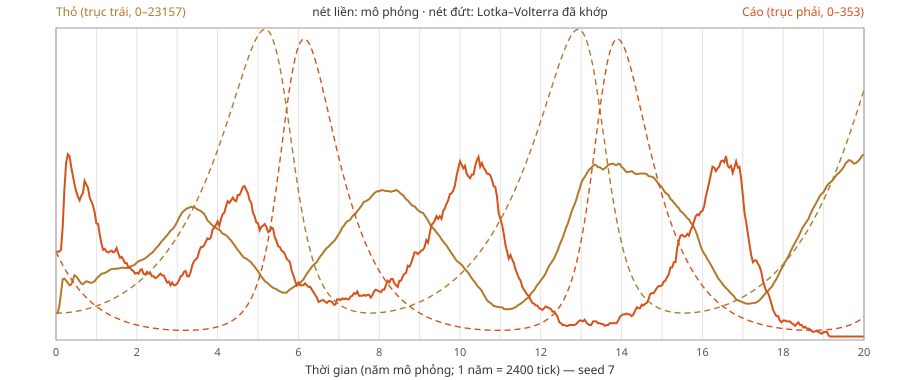

# Báo cáo — My Habitat

Mọi con số trong báo cáo này là kết quả **chạy thật** trên máy: Apple M1 Pro (8 nhân), 16 GB RAM, macOS,
Node v22.23.0; trình duyệt nhúng của Claude (Chrome 156, ANGLE Metal). Nhật ký gốc nằm trong `docs/data/`.

## 1. Kiến trúc và các quyết định thiết kế chính

Sơ đồ ở `README.md`. Các quyết định đáng nói:

| Quyết định | Vì sao |
|---|---|
| Lõi (`src/sim`, `src/species`) biên dịch riêng với `lib: ES2022`, không có DOM | Trình biên dịch chặn mọi phụ thuộc DOM; cùng một mã chạy trong Node, Worker, Vitest |
| Một RNG `sfc32`; cấm `Math.random/sin/exp/pow…`, `Date`, `performance` trong lõi bằng ESLint; `detmath.ts` chỉ dùng + − × ÷ √ | Các hàm siêu việt không được chuẩn quy định chính xác tới bit → có thể lệch giữa engine |
| Structure of Arrays cho cá thể; khe chết chỉ được tái dùng từ tick sau | Nhanh, chuyển sang luồng giao diện không cần copy; không nhầm con mới sinh với mục tiêu cũ |
| Spatial hash lưới đều (ô 25 u), dựng lại mỗi tick bằng counting sort; lọc theo loài trước khi đọc toạ độ | O(n), không có vòng lặp O(n²); đo được ~0,2–0,3 µs/cá thể/tick tới ~18.000 cá thể |
| Cỏ, cây bụi, tảo, côn trùng, nấm là trường mật độ 200×200, cập nhật 1/12 số hàng mỗi tick | Chi phí trường cố định ~0,24 ms/tick, không phụ thuộc quần thể |
| Loài = JSON; hành vi = danh sách module có tham số; `registry.ts` kiểm tra lúc nạp | Test `thêm loài mới chỉ bằng dữ liệu` chứng minh không cần sửa lõi; kịch bản Lotka–Volterra cũng chỉ là một phép biến đổi dữ liệu |
| Utility AI | Gấu đổi thức ăn theo mùa là hệ quả của điểm số (quả chỉ có cuối hạ–thu), không có lịch viết cứng |
| Sổ cái: mọi dòng năng lượng qua `Ledger.flow`; kho năng lượng dùng `Float64Array` | Kiểm toán từng kho tới ~1e‑12 |
| N:E cố định; quang hợp rút N tại ô, hô hấp trả N tại ô | Bảo toàn N trở thành hệ quả kiểm tra được; động vật vận chuyển dinh dưỡng |
| Worker gửi `RenderSnapshot` (typed array, transferable); giao diện xin ảnh mỗi khung hình | Renderer không thể chạm vào mô phỏng; tự điều tiết băng thông |
| Script CLI được Vite **đóng gói** rồi mới chạy | Module runner của Vite biến hằng số thành getter, chậm ~2,3×; bản đóng gói giống mã chạy trong trình duyệt |

**Thay đổi so với `PLAN.md`:** (1) kế hoạch ghi "không mô phỏng chăm sóc con non" — thực tế phải thêm (bú mẹ, theo
mẹ, ăn chung mồi, bầy sói nuôi chung) vì con non của loài ăn thịt không thể tự săn; (2) thêm ao nhỏ vào địa hình vì
có những vùng cách nước hàng trăm đơn vị; (3) thêm hệ "lãnh thổ sinh sản"; (4) mùa đông được làm ôn hoà hơn.

## 2. Ngách sinh thái của từng loài

| Loài | Ăn gì | Bị ai ăn | Ở đâu / lúc nào | Điều gì giữ cho nó không bị loại trừ |
|---|---|---|---|---|
| Cỏ | Ánh sáng + N đất | Thỏ, hươu, côn trùng, gấu | Đồng trống; thưa dưới tán rừng | Phần gốc không ai gặm tới được (sàn) + mọc lan từ ô bên |
| Cây bụi có quả | Ánh sáng + N | Hươu (lá), gấu/thỏ/cáo/hươu (quả) | Bìa rừng | Ít loài ăn được lá; chiếm ô mới nhờ hạt do thú thải ra |
| Tảo | Ánh sáng + N hoà tan | Cá, nòng nọc | Nước nông | Sàn không gặm được; nước sâu ít sáng nhưng cũng ít bị ăn |
| Côn trùng | Cỏ, lá bụi | Ếch, gấu, cáo | Khắp mặt đất, bùng nổ khi ấm | Sinh sản cực nhanh; ngủ đông dạng trứng/nhộng |
| Thỏ (chiến lược r) | Cỏ (gặm sát hơn hươu), quả | Cáo, đại bàng, sói | Đồng cỏ gần rừng | Đẻ 4 con/lứa, lớn sau ~1/10 năm; hang (nghỉ thì vô hình); rừng che mắt đại bàng |
| Hươu (chiến lược K) | Cỏ cao, **lá cây bụi**, quả | Sói (bầy) | Theo đàn, bơi qua sông | Nguồn riêng là lá bụi; to nên chỉ bầy sói hạ nổi; báo động lan trong đàn |
| Cáo | Thỏ, ếch; thêm quả, côn trùng, xác | — | Hoạt động đêm, giữ lãnh thổ | Săn đêm và trong rừng (đại bàng thì không); thức ăn thay thế nuôi con non |
| Sói | Hươu (bầy), thỏ, hươu non, xác | — | Bầy 2–8 con, lãnh thổ bầy | Loài duy nhất hạ được hươu trưởng thành; dai sức; cả bầy nuôi con chung |
| Đại bàng | Thỏ, cá nước nông, ếch | — | Bay, ban ngày, đồng trống | Bỏ qua sông núi; nhìn xa; không cạnh tranh được dưới tán rừng và ban đêm |
| Gấu | Quả (thu), cỏ + lá bụi (xuân–hạ), cá, côn trùng, xác | — | Rừng; ngủ đông | Ăn được gần như mọi thứ nhưng kém hiệu quả → mật độ thấp; ngủ qua mùa thiếu ăn |
| Ếch | Nòng nọc: tảo; ếch: côn trùng | Cáo, đại bàng | Trong ≤ 2 ô quanh nước; ngủ đông | Hai giai đoạn sống dùng hai nguồn thức ăn; nhảy xuống nước khi bị đe doạ |
| Cá | Tảo | Đại bàng, gấu (chỉ ở nước nông) | Mọi thuỷ vực | Nước sâu là nơi trú ẩn tuyệt đối khỏi kẻ săn |
| Kền kền | Chỉ xác | — | Bay lượn rất rẻ, tuần tra rộng | Thấy xác từ xa ở đồng trống; xác trong rừng dành cho nấm/gấu/cáo |
| Nấm | Mùn bã (phân, lá rụng, xác đã rữa) | — | Đất ẩm, ấm | Không ai cạnh tranh; trả N về đất, khép vòng dinh dưỡng |

Cạnh tranh được tách theo bốn trục: **thức ăn** (cỏ thấp/cỏ cao/lá bụi/quả/tảo/côn trùng/xác), **không gian**
(đồng trống/rừng/nước nông/nước sâu), **thời gian** (ngày/đêm, mùa, ngủ đông) và **cỡ con mồi**.

## 3. Lý do chọn các tham số mặc định

Tham số được chọn bằng suy luận cân bằng năng lượng rồi **hiệu chỉnh bằng chạy thật**; 9 vòng chạy 20 seed được giữ
lại trong `docs/data/stability-iteration-*.log`. Những tham số có lý do rõ nhất:

| Tham số | Giá trị | Lý do (và điều đo được dẫn tới nó) |
|---|---|---|
| Chuyển hoá cơ bản 0,0052·M^0,75 | — | Để hiệu suất sản xuất (P/C) của thú hằng nhiệt rơi quanh 4–14% (đo: mục 4) |
| Năng suất cỏ `growthRate` 0,004, `capacity` 200 | — | Sức chứa thỏ ~5.000: đủ nuôi ba loài ăn thịt, tổng < 11.000 cá thể. Ở 0,012/300 thỏ lên 20.000 |
| Sàn gặm cỏ: thỏ 6, hươu 12 | — | Thỏ gặm sát hơn nên không bị hươu ép chết; hươu có lá bụi làm nguồn riêng |
| Thỏ: 4 con/lứa, nghỉ 600 tick, sống 3.600 tick | — | R₀ đủ cao để chịu săn. Ở mức nghỉ 1.100 tick, thỏ chỉ vừa đủ thay thế và sụp khi kẻ săn tăng |
| Tốc độ chạy: cáo 2,9 > thỏ 2,3; sói 2,8 > hươu 2,6; sức bền sói 420 ≫ hươu 90 | — | Khi tốc độ ngang nhau, cáo chỉ bắt được 131 thỏ/năm và chết đói |
| Khoảng cách rình/vồ 32–55 u; con mồi hoảng ở 0,45–0,7 tầm nhìn | — | Tạo "cuộc đua" giữa tầm nhìn con mồi và sự kín đáo của kẻ săn |
| Lãnh thổ sinh sản: cáo 200, đại bàng 330, sói 450, gấu 450 u | — | Đo số con cái giữ được lãnh thổ: ở 300/450 cáo chỉ có ~17, đại bàng 8 → suy giảm; không có lãnh thổ thì cáo lên 245 và ăn thỏ từ 5.000 còn 6 |
| Ao: thêm tới khi không ô đất nào cách nước > 24 ô | ~46–49 ao | Trước đó thú ở vùng khô chết khát trên đường đi uống |
| Nước từ thức ăn (cỏ tươi, thịt) | — | Khi đất ẩm thú không cần uống; hạn hán mới dồn chúng về nguồn nước |
| Khí hậu 13 ± 10 °C, ánh sáng mùa đông 40% | — | Với mùa đông năng suất bằng 0, con trưởng thành của mọi loài chết đói hàng loạt mỗi mùa xuân |
| Đột biến 10%/alen, σ = 4% biên độ | — | Đủ biến dị để chọn lọc có nguyên liệu mà không làm nhoè kiểu hình trong vài thế hệ |
| Phân loài: cách ly 6.000 tick, khoảng cách 1,2σ, quần thể con ≥ 30 | — | Với 0,9σ/12 cá thể và so từng cặp, 6 seed sinh 129 "phân loài" do nhiễu lấy mẫu ở các ao nhỏ |

## 4. Kết quả test ổn định

Lệnh: `pnpm stability` (20 seed × 20.000 tick, 6 worker song song, 162 giây). Nhật ký: `docs/data/stability-final.log`.

**Kết quả: 19/20 seed** giữ được cả 14 loài khởi đầu qua 20.000 tick. Seed 8 mất cáo ở tick 14.500.
Mỗi ô: số cá thể cuối (số nhỏ nhất trong suốt lần chạy).

| Seed | Kết quả | Thỏ | Hươu | Cáo | Sói | Đại bàng | Gấu | Ếch | Cá | Kền kền | Đỉnh tổng |
|---|---|---:|---:|---:|---:|---:|---:|---:|---:|---:|---:|
| 1 | ✓ | 5225 (1394) | 437 (320) | 156 (63) | 8 (4) | 15 (10) | 23 (23) | 96 (56) | 742 (196) | 1 (1) | 9348 |
| 2 | ✓ | 5981 (1388) | 210 (187) | 54 (29) | 24 (19) | 30 (23) | 21 (21) | 130 (94) | 564 (171) | 159 (9) | 10870 |
| 3 | ✓ | 4112 (1386) | 287 (274) | 62 (41) | 30 (14) | 44 (31) | 16 (16) | 240 (135) | 305 (98) | 98 (10) | 8772 |
| 4 | ✓ | 5290 (1375) | 300 (280) | 83 (55) | 10 (4) | 31 (25) | 29 (29) | 44 (38) | 600 (115) | 134 (11) | 9673 |
| 5 | ✓ | 6117 (1385) | 211 (195) | 42 (26) | 64 (35) | 41 (29) | 31 (31) | 222 (189) | 469 (239) | 72 (5) | 9709 |
| 6 | ✓ | 4952 (1388) | 350 (329) | 101 (36) | 31 (22) | 21 (15) | 24 (24) | 119 (95) | 557 (199) | 80 (5) | 8732 |
| 7 | ✓ | 5145 (1391) | 255 (194) | 126 (48) | 14 (8) | 73 (35) | 10 (10) | 71 (71) | 431 (174) | 27 (6) | 10050 |
| 8 | ✗ fox@14500 | 7035 (1381) | 210 (181) | 0 (0) | 21 (15) | 23 (21) | 20 (20) | 35 (35) | 433 (78) | 88 (10) | 9939 |
| 9 | ✓ | 5897 (1390) | 329 (311) | 73 (38) | 36 (24) | 21 (20) | 34 (34) | 39 (22) | 410 (133) | 20 (4) | 10495 |
| 10 | ✓ | 3434 (1385) | 376 (306) | 70 (33) | 28 (23) | 50 (33) | 23 (23) | 268 (93) | 294 (132) | 73 (8) | 9433 |
| 11 | ✓ | 4351 (1392) | 246 (226) | 64 (34) | 25 (18) | 38 (28) | 25 (25) | 174 (116) | 471 (76) | 115 (7) | 9415 |
| 12 | ✓ | 5571 (1386) | 243 (204) | 58 (24) | 31 (22) | 22 (19) | 17 (17) | 178 (107) | 321 (105) | 160 (8) | 10072 |
| 13 | ✓ | 4330 (1391) | 357 (292) | 124 (49) | 21 (11) | 19 (14) | 24 (24) | 77 (77) | 486 (109) | 90 (11) | 9341 |
| 14 | ✓ | 5983 (1383) | 323 (289) | 25 (18) | 37 (17) | 56 (36) | 19 (19) | 48 (48) | 394 (109) | 32 (4) | 9729 |
| 15 | ✓ | 5931 (1384) | 314 (281) | 59 (25) | 13 (11) | 36 (20) | 26 (26) | 38 (33) | 360 (90) | 77 (6) | 9133 |
| 16 | ✓ | 6022 (1381) | 324 (255) | 44 (25) | 13 (8) | 31 (24) | 23 (23) | 136 (100) | 330 (106) | 138 (6) | 9109 |
| 17 | ✓ | 4907 (1393) | 280 (239) | 51 (32) | 12 (8) | 59 (36) | 30 (30) | 122 (104) | 562 (141) | 142 (9) | 10292 |
| 18 | ✓ | 5911 (1382) | 282 (269) | 84 (29) | 40 (21) | 40 (31) | 19 (19) | 131 (70) | 531 (211) | 49 (8) | 9616 |
| 19 | ✓ | 6261 (1384) | 415 (330) | 53 (35) | 23 (17) | 42 (30) | 38 (36) | 87 (79) | 536 (134) | 130 (7) | 9661 |
| 20 | ✓ | 5595 (1394) | 369 (327) | 66 (26) | 13 (9) | 40 (28) | 22 (22) | 188 (156) | 495 (167) | 163 (12) | 9782 |

Cả 5 trường (cỏ, cây bụi, tảo, côn trùng, nấm) tồn tại ở cả 20 seed.

**Phân tích seed thất bại (seed 8):** cáo giảm 90 → 82 (tick 3.000) → 32 (4.500) → 20 (6.000–7.500) → 10 → 5 → 0,
trong khi thỏ tăng từ 4.200 lên 5.000–7.400 — tức không phải thiếu mồi. Sau cú sụt đầu, quần thể chỉ còn khoảng mươi
con cái sinh sản; ở cỡ đó vài năm liền con non sống sót kém là đủ để không hồi phục (ngẫu nhiên nhân khẩu học). Tôi
chưa xác định được vì sao cú sụt đầu ở seed này sâu hơn các seed khác. Đây là điểm yếu còn lại của mô hình (mục 8).

**Lịch sử cải thiện (đều là chạy thật 20 seed):** 13/20 → 16/20 (nuôi con lâu hơn, con non ăn chung mồi) → 10/20
(thử cho sói 2 con cái sinh sản/bầy, cáo biết bơi — kẻ săn tăng quá mức) → 17/20 (siết sinh sản của cáo/đại bàng,
rừng thành nơi trú ẩn) → 15/20 → 19/20 (bầy sói nuôi con chung) → phát hiện luật lãnh thổ không có hiệu lực với con
đực chủ động giao phối → sửa → 16/20 → **19/20** (chỉnh bán kính lãnh thổ theo số đo). Không có lần nào dùng trần
số lượng, hồi sinh loài sắp tuyệt chủng, hay ngoại lệ riêng cho một loài.

**Chưa đạt ở mốc dài hơn:** chạy 50.000 tick với seed 42 (`docs/data/long-run-seed42-final.log`): sói tuyệt chủng ở
tick 25.300 và ếch ở tick 47.500; 12 loài còn lại tồn tại. Tức hệ **chưa** ổn định vô thời hạn.

**Năng lượng (trung bình 20 seed):**

| Chỉ số | Giá trị |
|---|---|
| Sai số sổ cái lớn nhất (mọi kho, mọi seed) | 9,4 × 10⁻¹³ (tương đối) |
| Sai số bảo toàn dinh dưỡng lớn nhất | 1,3 × 10⁻¹⁴ |
| Hiệu suất sản xuất P/C: thỏ 5,9% · hươu 3,7% · cáo 13,6% · sói 8,3% · đại bàng 7,1% · gấu 3,7% · ếch 21,5% · cá 9,1% · kền kền 10,1% | quanh mức 10% (hằng nhiệt thấp hơn, biến nhiệt cao hơn — đúng chiều thực tế) |
| Lượng ăn của bậc 2 / sản lượng sơ cấp | 47% |
| Lượng ăn của bậc 3 / lượng ăn của bậc 2 | **2,4%** — thấp hơn mốc 10% |

Nói thẳng: *hiệu suất sản xuất* của từng loài quanh 10%, nhưng *dòng truyền* từ bậc 2 lên bậc 3 chỉ 2,4% vì kẻ săn
(bị lãnh thổ giới hạn) chỉ ăn một phần nhỏ sản lượng của thú ăn cỏ; phần lớn thú ăn cỏ chết già hoặc chết đói rồi đi
vào nhánh phân huỷ (kền kền, nấm).

## 5. Hiệu năng đo được

**Lõi, trong Node** (`pnpm bench`, `docs/data/bench.json`), seed 42, 3.000 tick, trung bình **1,92 ms/tick** với
4.600–10.000 cá thể:

| Hệ con | ms/tick | Tỉ lệ |
|---|---:|---:|
| Động vật (giác quan, hành vi, di chuyển) | 1,529 | 80% |
| Trường (cỏ, bụi, tảo, côn trùng, nấm, N) | 0,236 | 12% |
| Dựng spatial hash + danh sách loài | 0,148 | 8% |
| Xác, bầy, lãnh thổ, phân loài | 0,007 | 0% |

| Số cá thể (× số lượng khởi đầu) | ms/tick | µs/cá thể |
|---:|---:|---:|
| 2.163 (×0,5) | 0,57 | 0,27 |
| 4.448 (×1) | 1,04 | 0,24 |
| 9.142 (×2) | 2,38 | 0,26 |
| 18.192 (×4) | 6,13 | 0,34 |
| 35.004 (×8) | 18,28 | 0,52 |

Chi phí mỗi cá thể gần như phẳng tới ~18.000 cá thể (tuyến tính); ở 35.000 tăng gấp đôi vì mật độ hàng xóm tăng.
Tốc độ "×100" (3.000 tick/giây) **không** đạt được với quần thể mặc định: máy này đạt ~500 tick/giây.

**Hiển thị, trong trình duyệt** (khung nhìn 1020×853 px CSS, tỉ lệ điểm ảnh 2, màn hình 120 Hz, mô phỏng đang
chạy ×1; đo bằng `habitat.measureFps()` qua `requestAnimationFrame` trong 3–4 giây):

| Chế độ | Cá thể (đang thấy) | FPS | CPU mỗi khung |
|---|---:|---:|---:|
| 2D, LOD 0, toàn bản đồ | 7.803 (7.803) | 95,7 | 0,82 ms |
| 2D, LOD 1 (zoom 0,95) | 7.568 (1.177) | 95,1 | 2,38 ms |
| 2D, LOD 2 (zoom 2,5) | 7.380 (201) | 94,7 | 2,28 ms |
| 2D, LOD 2 (zoom 6) | 7.276 (33) | 95,3 | 1,23 ms |
| 3D, toàn cảnh | 9.407 | 94,3 | 2,58 ms (22 lệnh vẽ, 5,4 triệu tam giác) |
| 3D, bám theo một con hươu | 9.159 | 94,3 | 2,57 ms |

Cả hai mục tiêu (2D ≥ 5.000 cá thể ở 60 fps; 3D ≥ 2.000 ở 60 fps) đều vượt. **Lưu ý về độ tin cậy:** đo trong
khung trình duyệt nhúng đang ở trạng thái ẩn nên nhịp khung bị trần ~95 fps và có khung chậm lẻ tẻ 34–42 ms; con số
"CPU mỗi khung" đáng tin hơn FPS. LOD 1/LOD 2 không thể hiện 5.000 cá thể cùng lúc vì khung nhìn đã bị cắt.

**Tất định Node ↔ Worker:** seed 42, 1.500 tick, đo ở trạng thái mã cuối cùng. `pnpm sim` (Node) và
`habitat.client.run()` (Web Worker trong Chrome 156, có đổi 2D→3D→2D giữa chừng) cho cùng chuỗi băm
`0b71507fbd98a66c`. Worker chạy 1,95 ms/tick ở chế độ dev. Test tự động còn so bản đóng gói với bản chạy qua Vitest
và với worker thread của Node.

## 6. Dự đoán sau 50.000 tick — và điều thực sự xảy ra

Dự đoán được viết từ cơ chế của mô hình, rồi đối chiếu với lần chạy 50.000 tick (seed 42, `docs/data/long-run-genes.txt`).

| Dự đoán | Vì sao | Thực tế (seed 42) |
|---|---|---|
| Thỏ, cá **nhỏ đi** | To hơn tốn M^0,75 và lớn lâu hơn; lợi ích "khó bị hạ" gần như vô nghĩa với loài bị giết bằng một đòn | ✓ thỏ 1,00 → 0,93; cá 1,00 → 0,92 |
| Kẻ săn **nhanh hơn** một chút | Bắt hụt là mất bữa; chi phí chạy chỉ trả khi chạy | ✓ cáo +0,02, đại bàng +0,04, gấu +0,03 |
| Thỏ **không** nhanh lên rõ | Thoát thân nhờ hang/rừng/phát hiện sớm hơn là nhờ tốc độ; nuôi cơ tốn quanh năm | ✓ 1,00 → 1,01 |
| Tầm nhìn của thỏ **tăng** | Thấy kẻ săn sớm thì chạy thoát | ✗ **giảm** 1,00 → 0,94: chi phí chuyển hoá của tầm nhìn lớn hơn lợi ích khi đã có hang và rừng |
| Tầm nhìn của cáo, gấu tăng | Thấy mồi/xác từ xa | ✓ cáo 1,05; gấu 1,05 |
| Chịu lạnh **giảm** | Mùa đông ôn hoà, lông dày chỉ còn là chi phí và làm nóng mùa hạ | ✓ thỏ 0,45 → 0,42; cáo 0,50 → 0,46; đại bàng 0,50 → 0,45 |
| Gấu **thiên ăn thịt hơn** | Xác thú chết đói/chết già dồi dào quanh năm | ✓ 0,39 → 0,44 |
| Màu lông dịch về màu nền | Nguỵ trang giảm tầm bị phát hiện | ~ gần như không đổi: áp lực yếu hơn các gen khác trong 50.000 tick |
| Phân loài sớm nhất ở **ếch và cá** trong thuỷ vực cô lập | Quần thể con nhỏ (30–80) → trôi dạt nhanh; không có dòng gen giữa các hồ | ✓ Ếch α @13.200 (33 cá thể, 1,32σ; tuyệt chủng @23.400), Cá α @46.800 (34 cá thể, 1,20σ) |
| Thỏ hai bờ sông **chưa** tách trong 50.000 tick | Mỗi bờ hàng nghìn con → trôi dạt rất chậm; cần chọn lọc khác nhau giữa hai bờ | ✓ chưa tách |
| Chim, sói, hươu, gấu **không bao giờ** tách | Bay hoặc bơi qua sông → luôn có dòng gen | ✓ |

Điểm sai (tầm nhìn của thỏ) là một phát hiện thật của mô hình chứ không phải thứ được cài sẵn.

## 7. Đã làm đầy đủ / đã đơn giản hoá / chưa làm

**Đã làm đầy đủ**

- Lõi TS thuần, không DOM, chạy trong Node/Worker; bước cố định; một RNG có seed; SoA; spatial hash.
- 14 loài khởi đầu, mỗi loài có cơ chế riêng; loài và hành vi định nghĩa bằng dữ liệu (14 module hành vi).
- Bản đồ 2000×2000 từ noise: hồ, ao, sông chia đôi bản đồ (có test), đồng cỏ, rừng, đồi núi; ngày/đêm, bốn mùa,
  mưa/hạn; rừng che tầm nhìn, núi và nước sâu cản đường.
- Di truyền lưỡng bội, đột biến, đánh đổi qua chi phí năng lượng; phân loài + cây phát sinh.
- Sổ cái năng lượng và vòng dinh dưỡng khép kín, có test bảo toàn (kể cả khi có thảm hoạ).
- 2D: vẽ bằng code theo gen, hoạt ảnh, 3 mức LOD, zoom/kéo. 3D: heightmap, nước, cây, InstancedMesh, camera tự do
  và bám theo; đổi 2D↔3D khi đang chạy.
- Giao diện: biểu đồ quần thể (theo loài và phân loài), histogram + bản đồ nhiệt gen theo thời gian, lưới thức ăn
  trực tiếp, inspector (gen, hai alen, phả hệ 3 đời), cây phân loài, thanh trượt, 5 loại thảm hoạ, tạm dừng/×1/×10/
  ×100/tối đa/không vẽ, seed, xuất CSV.
- Chế độ thí nghiệm Lotka–Volterra có khớp tham số và vẽ chồng; CLI; 53 test; README; tài liệu mô hình.

**Đã đơn giản hoá** (chi tiết ở `docs/MODELS.md`)

- Cỏ, cây bụi, tảo, côn trùng, nấm là trường mật độ, không có bộ gen. Cây rừng là địa hình tĩnh.
- Không tìm đường toàn cục. Phát hiện bằng ngưỡng tất định. Trứng nở ngay; "bú" là chuyển năng lượng.
- Một nguyên tố dinh dưỡng; một mực nước chung; mưa đồng đều.
- Trong 3D, gen tầm nhìn không hiện ra ngoại hình (2D thì có: cỡ mắt, tai thỏ).
- Cáo được cho bơi qua sông (để hai bờ là một quần thể) — nên rào cản sông chỉ cô lập thỏ.
- Phả hệ nhớ 131.072 cá thể gần nhất.

**Chưa làm / chưa đạt**

- Ổn định: 19/20 chứ không phải 20/20; ở 50.000 tick có loài tuyệt chủng (mục 4).
- Dòng truyền bậc 2 → 3 là 2,4%, không phải ~10% (mục 4).
- Tốc độ ×100 không đạt 3.000 tick/giây với quần thể mặc định (~500 tick/giây).
- Chưa đo FPS trong một cửa sổ trình duyệt bình thường (không nhúng, đang hiện).
- Chưa kiểm chứng tất định trên Firefox/Safari (thiết kế tránh hàm siêu việt là để đạt điều này, nhưng chưa chạy thử).
- Không có lưu/tải trạng thái mô phỏng.

## 8. Giới hạn của mô hình và những điểm chưa chắc chắn

1. **Quần thể kẻ săn nhỏ.** Sói, gấu, đại bàng, cáo ở mức 15–100 con với 5–35 con cái sinh sản. Ở cỡ này ngẫu nhiên
   nhân khẩu học chi phối; "19/20 trong 20.000 tick" không suy rộng ra thời gian dài hơn.
2. **Cân bằng nhạy với tham số.** Bán kính lãnh thổ là đòn bẩy mạnh nhất: lệch ±30% là chuyển từ "kẻ săn suy tàn" sang
   "kẻ săn ăn sạch con mồi". Tôi chỉnh nó theo số đo, nhưng không chứng minh được vùng tham số ổn định là rộng.
3. **Bản thân tôi đã mắc lỗi trong quá trình.** Luật lãnh thổ từng vô hiệu qua 6 vòng cân chỉnh (con đực vẫn giao phối
   với con cái không có lãnh thổ) và chỉ lộ ra nhờ lần chạy 50.000 tick. Có thể còn lỗi tương tự chưa lộ.
4. **Thang thời gian không nhất quán:** vòng đời nén hàng trăm lần so với chu kỳ ngày.
5. **Chọn lọc yếu trên màu lông** trong các lần chạy đã đo; phần "nhìn thấy tiến hoá bằng mắt" rõ nhất ở kích thước.
6. **Phân loài** dùng vùng địa lý theo mực nước nền và một ngưỡng thống kê; con số 1,2σ là lựa chọn của tôi.
7. **Seed thất bại chưa được sửa** (seed 8), và tôi chưa chạy đủ nhiều seed để ước lượng tỉ lệ thất bại thật.

## 9. Thí nghiệm Lotka–Volterra

`pnpm lv --seed 7 --ticks 48000` (`docs/data/lotka-volterra.{csv,json,svg}`): đồng cỏ phẳng, không mùa/ngày đêm/thời
tiết/khát/biến dị; chỉ cỏ, thỏ, cáo; cáo chỉ săn thỏ nhìn thấy được, không lãnh thổ, sinh sản quanh năm.

| | Mô phỏng | Lotka–Volterra đã khớp |
|---|---|---|
| Tham số | — | α = 2,90×10⁻⁴, β = 3,03×10⁻⁶, δ = 6,26×10⁻⁸, γ = 5,39×10⁻⁴ (R² = 0,55 / 0,34) |
| Chu kỳ | 12.500 tick | 15.894 tick |
| Đỉnh cáo trễ sau đỉnh thỏ | 39% chu kỳ | 25% chu kỳ |
| Trung bình thỏ / cáo | 7.394 / 86 | N* = 8.611 / P* = 96 |
| Biên độ thỏ | 1.992 – 13.784 | 1.999 – 23.056 |
| Biên độ cáo | 4 – 210 | 11 – 340 |

**Vì sao lệch:** (1) thỏ bị cỏ giới hạn ở ~13.800 con nên đỉnh bị cắt, còn L–V cho tăng không giới hạn; (2) cáo no
thì ngừng săn (Holling II) nên không khai thác hết đỉnh thỏ; (3) sinh sản của cáo có độ trễ mang thai + nuôi con +
lớn lên, nên pha trễ 39% thay vì 25%; (4) không gian: thỏ bị ăn cạn theo từng vùng, cáo phải đi tìm; (5) quần thể hữu
hạn — ở đáy chu kỳ chỉ còn 4 con cáo, và trong vài lần chạy thử cáo đã tuyệt chủng ở đáy (L–V liên tục thì không
bao giờ). R² thấp (0,55/0,34) cho thấy L–V chỉ giải thích được một phần biến động.
